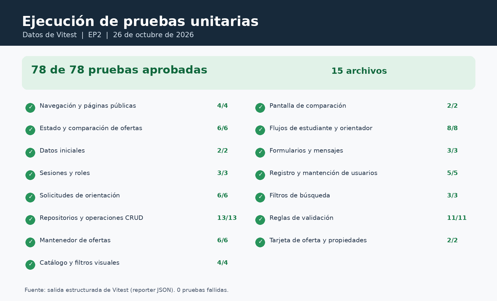
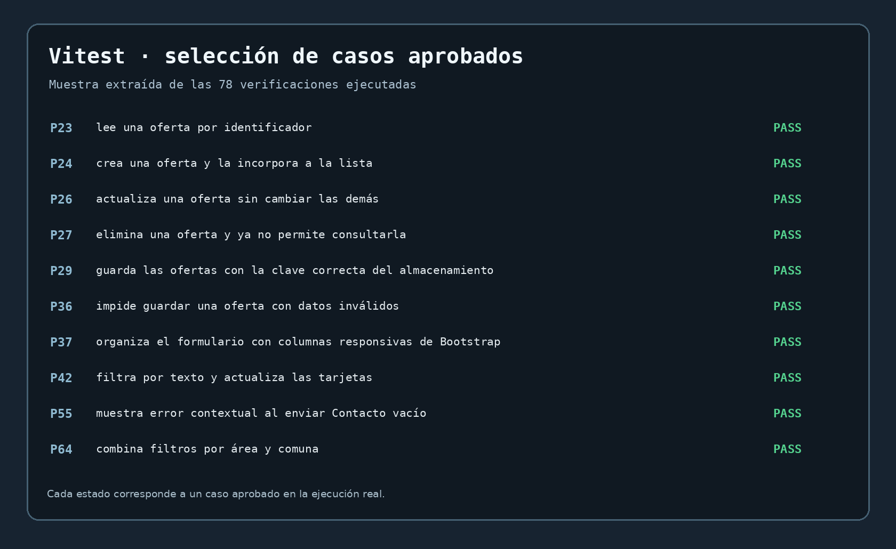
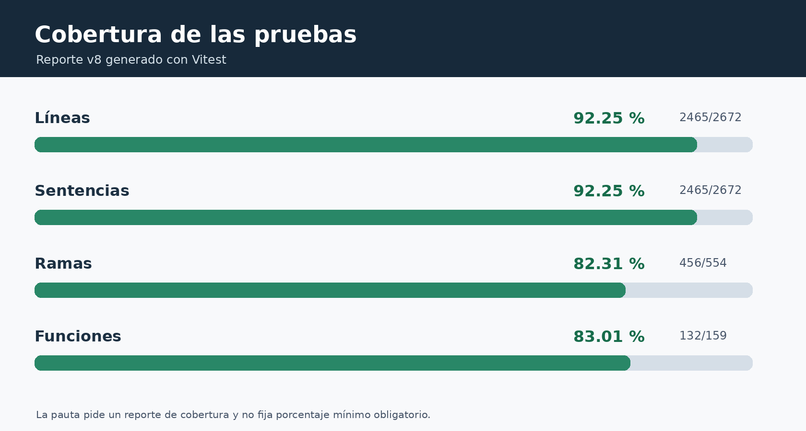

# Informe de pruebas unitarias y cobertura — EduBío 360

Evaluación Parcial 2 · DSY1104 · 26 de octubre de 2026

## Índice

1. Objetivo y pauta
2. Herramientas y ejecución
3. Resultados
4. Casos explicados
5. Registro completo
6. Evidencias
7. Cobertura
8. Posibles fallos y pendientes
9. Conclusión

## 1. Objetivo y pauta

Comprobar renderizado, propiedades, listas, eventos, validaciones, condiciones, filtros y las cuatro operaciones CRUD.
La pauta exige al menos 15 pruebas aprobadas y un reporte de cobertura; no fija cobertura mínima.

## 2. Herramientas y ejecución

Se utiliza Vitest, React Testing Library, jsdom, user-event, espías y cobertura v8.
Para reproducir: desde `ep2`, ejecutar `npm ci`, `npm run test:coverage` y `npm run build`.
El reporte HTML se encuentra en `coverage/index.html`.

## 3. Resultados

**78/78 pruebas aprobadas en 15 archivos; 0 fallidas.**

## 4. Casos explicados

### P24. Crea una oferta y la incorpora a la lista

- Preparación: Partir de un repositorio con sus ofertas.
- Acción: Crear una oferta con identificador nuevo.
- Resultado esperado: La nueva oferta queda disponible en el listado.
- Posible fallo: El registro creado no figura en la lista.
- Resultado real: aprobada.

### P23. Lee una oferta por identificador

- Preparación: Disponer de una oferta almacenada.
- Acción: Consultar el identificador de esa oferta.
- Resultado esperado: Se obtiene el registro correspondiente.
- Posible fallo: La consulta entrega otra oferta o ninguna.
- Resultado real: aprobada.

### P26. Actualiza una oferta sin cambiar las demás

- Preparación: Cargar varias ofertas existentes.
- Acción: Editar solamente una oferta.
- Resultado esperado: Cambia el registro elegido y los otros se conservan.
- Posible fallo: La edición altera registros diferentes.
- Resultado real: aprobada.

### P27. Elimina una oferta y ya no permite consultarla

- Preparación: Preparar una oferta existente.
- Acción: Eliminarla y volver a consultarla.
- Resultado esperado: La oferta deja de existir en el repositorio.
- Posible fallo: Un registro eliminado continúa disponible.
- Resultado real: aprobada.

### P42. Filtra por texto y actualiza las tarjetas

- Preparación: Mostrar el catálogo completo.
- Acción: Ingresar una búsqueda en la interfaz.
- Resultado esperado: Las tarjetas se actualizan según las coincidencias.
- Posible fallo: La búsqueda no actualiza las tarjetas.
- Resultado real: aprobada.

### P64. Combina filtros por área y comuna

- Preparación: Contar con ofertas de distintas áreas y comunas.
- Acción: Aplicar los dos criterios de búsqueda.
- Resultado esperado: Solo se devuelven las ofertas que satisfacen ambos.
- Posible fallo: Se ignora alguno de los filtros combinados.
- Resultado real: aprobada.

### P36. Impide guardar una oferta con datos inválidos

- Preparación: Abrir el formulario administrativo.
- Acción: Completarlo con valores no válidos e intentar guardar.
- Resultado esperado: Se muestra la validación y no se crea el registro.
- Posible fallo: Se guarda una oferta con datos obligatorios erróneos.
- Resultado real: aprobada.

### P29. Guarda las ofertas con la clave correcta del almacenamiento

- Preparación: Preparar almacenamiento local y espiar setItem.
- Acción: Guardar cambios por medio del repositorio.
- Resultado esperado: Se invoca la clave esperada y se conserva el contenido.
- Posible fallo: Se guarda bajo otra clave o no se llama al almacenamiento.
- Resultado real: aprobada.

### P37. Organiza el formulario con columnas responsivas de Bootstrap

- Preparación: Renderizar el formulario de edición de ofertas.
- Acción: Inspeccionar las clases de sus columnas.
- Resultado esperado: Están presentes las clases responsive verificadas.
- Posible fallo: Faltan clases de columna de Bootstrap.
- Resultado real: aprobada.

### P55. Muestra error contextual al enviar Contacto vacío

- Preparación: Abrir el formulario de contacto.
- Acción: Intentar enviarlo sin completar los campos.
- Resultado esperado: Se muestran los mensajes de error correspondientes.
- Posible fallo: Se omiten errores al enviar un contacto vacío.
- Resultado real: aprobada.

## 5. Registro completo de pruebas

Los posibles fallos descritos son hipótesis verificables, no fallos ocurridos.

### Navegación y páginas públicas

| N.º | Función y comportamiento esperado | Posible fallo | Resultado |
|---|---|---|---|
| P01 | Muestra la portada y la navegación principal | La portada o el menú no aparecen. | Aprobada |
| P02 | Muestra la página Nosotros | La ruta Nosotros no muestra el contenido. | Aprobada |
| P03 | Muestra ambas novedades y acceso a detalles | Falta una novedad o su enlace de detalle. | Aprobada |
| P04 | Muestra ruta de página inexistente | Una dirección desconocida deja la pantalla en blanco. | Aprobada |

### Estado y comparación de ofertas

| N.º | Función y comportamiento esperado | Posible fallo | Resultado |
|---|---|---|---|
| P05 | Agrega a comparar y evita duplicados al pulsar dos veces | Una oferta se añade dos veces a la comparación. | Aprobada |
| P06 | Actualiza inmediatamente las listas al crear una oferta | El listado no refleja la oferta recién creada. | Aprobada |
| P07 | Persiste selección de comparación en LocalStorage | La selección se pierde al recuperar el almacenamiento. | Aprobada |
| P08 | Permite comparar como máximo tres ofertas equivalentes como en EP1 | Se permiten más de tres ofertas comparables. | Aprobada |
| P09 | No mezcla carreras de distintos grupos de comparación | Se comparan carreras de grupos incompatibles. | Aprobada |
| P10 | Actualiza las ofertas cuando otra pestaña modifica el almacenamiento | Los cambios de otra pestaña no se reflejan. | Aprobada |

### Datos iniciales

| N.º | Función y comportamiento esperado | Posible fallo | Resultado |
|---|---|---|---|
| P11 | Conserva las 21 ofertas y sus identificadores originales | Faltan ofertas o cambian sus identificadores. | Aprobada |
| P12 | Incluye cuentas de ejemplo de los tres roles del proyecto original | Falta un usuario de alguno de los tres roles. | Aprobada |

### Sesiones y roles

| N.º | Función y comportamiento esperado | Posible fallo | Resultado |
|---|---|---|---|
| P13 | Inicia sesión con una cuenta activa y dirige al panel de su rol | Una cuenta activa no puede acceder a su panel. | Aprobada |
| P14 | Rechaza contraseñas incorrectas y cuentas inactivas | Se admite una clave incorrecta o una cuenta inactiva. | Aprobada |
| P15 | Cierra la sesión y no recupera cuentas eliminadas | La sesión sigue abierta o reaparece una cuenta eliminada. | Aprobada |

### Solicitudes de orientación

| N.º | Función y comportamiento esperado | Posible fallo | Resultado |
|---|---|---|---|
| P16 | Crea la solicitud con estado pendiente, historial y notificación | La solicitud no queda pendiente ni registra su historial. | Aprobada |
| P17 | Solo permite a un orientador tomar solicitudes disponibles | Un usuario sin el rol requerido toma la solicitud. | Aprobada |
| P18 | No permite a otros estudiantes cancelar solicitudes ajenas | Un estudiante modifica solicitudes ajenas. | Aprobada |
| P19 | Valida fecha futura y resultado antes de finalizar | Se acepta una fecha anterior o se cierra sin resultado. | Aprobada |
| P20 | Permite reprogramar con una fecha válida y marcar las notificaciones leídas | Se admite fecha inválida o no se marcan avisos leídos. | Aprobada |
| P21 | Conserva las ofertas comparadas al solicitar orientación | La solicitud pierde las ofertas comparadas. | Aprobada |

### Repositorios y operaciones CRUD

| N.º | Función y comportamiento esperado | Posible fallo | Resultado |
|---|---|---|---|
| P22 | Entrega ofertas iniciales al comenzar con almacenamiento vacío | No aparecen los datos iniciales con almacenamiento vacío. | Aprobada |
| P23 | Lee una oferta por identificador | La consulta entrega otra oferta o ninguna. | Aprobada |
| P24 | Crea una oferta y la incorpora a la lista | El registro creado no figura en la lista. | Aprobada |
| P25 | Rechaza un identificador de oferta duplicado | Se aceptan dos ofertas con el mismo identificador. | Aprobada |
| P26 | Actualiza una oferta sin cambiar las demás | La edición altera registros diferentes. | Aprobada |
| P27 | Elimina una oferta y ya no permite consultarla | Un registro eliminado continúa disponible. | Aprobada |
| P28 | Persiste cambios entre nuevas instancias | Los datos se pierden al crear una nueva instancia. | Aprobada |
| P29 | Guarda las ofertas con la clave correcta del almacenamiento | Se guarda bajo otra clave o no se llama al almacenamiento. | Aprobada |
| P30 | Recupera datos iniciales si el almacenamiento contiene JSON inválido | Un JSON dañado bloquea la carga de ofertas. | Aprobada |
| P31 | Rechaza campos inválidos almacenados sin romper el catálogo | Registros inválidos se muestran o rompen la carga. | Aprobada |
| P32 | Crea y recupera un usuario | El usuario creado no puede recuperarse. | Aprobada |
| P33 | Actualiza rol de un usuario | El nuevo rol no queda guardado. | Aprobada |
| P34 | Elimina un usuario y conserva el resto | La eliminación borra otro usuario o no borra el indicado. | Aprobada |

### Mantenedor de ofertas

| N.º | Función y comportamiento esperado | Posible fallo | Resultado |
|---|---|---|---|
| P35 | Muestra el listado e inicia el flujo de eliminación confirmado | No aparece el listado o se elimina sin confirmación. | Aprobada |
| P36 | Impide guardar una oferta con datos inválidos | Se guarda una oferta con datos obligatorios erróneos. | Aprobada |
| P37 | Organiza el formulario con columnas responsivas de Bootstrap | Faltan clases de columna de Bootstrap. | Aprobada |
| P38 | Crea una oferta desde el formulario y actualiza el listado | El formulario no incorpora la nueva oferta al listado. | Aprobada |
| P39 | Edita una oferta existente y refleja el nombre actualizado | La edición no modifica el nombre mostrado. | Aprobada |
| P40 | Permite actualizar los cupos disponibles de una oferta original | Los cupos editados no quedan actualizados. | Aprobada |

### Catálogo y filtros visuales

| N.º | Función y comportamiento esperado | Posible fallo | Resultado |
|---|---|---|---|
| P41 | Renderiza todas las ofertas iniciales | No se muestran todas las ofertas iniciales. | Aprobada |
| P42 | Filtra por texto y actualiza las tarjetas | La búsqueda no actualiza las tarjetas. | Aprobada |
| P43 | Muestra estado vacío y permite limpiar filtros | No aparece el mensaje vacío o falla limpiar filtros. | Aprobada |
| P44 | Muestra estado no encontrado para identificador inexistente | El detalle inexistente muestra datos incorrectos. | Aprobada |

### Pantalla de comparación

| N.º | Función y comportamiento esperado | Posible fallo | Resultado |
|---|---|---|---|
| P45 | Explica qué hacer cuando aún no hay ofertas seleccionadas | La pantalla vacía no orienta al usuario. | Aprobada |
| P46 | Permite eliminar una oferta previamente agregada | Una oferta quitada sigue apareciendo. | Aprobada |

### Flujos de estudiante y orientador

| N.º | Función y comportamiento esperado | Posible fallo | Resultado |
|---|---|---|---|
| P47 | Protege la vista de estudiante cuando no existe sesión | El panel estudiantil queda accesible sin sesión. | Aprobada |
| P48 | Permite iniciar sesión como estudiante y abrir su panel | El estudiante no accede a su panel tras entrar. | Aprobada |
| P49 | Muestra las sedes que ya existían en el mapa EP1 | El mapa omite sedes presentes en el proyecto original. | Aprobada |
| P50 | Envía una consulta desde la vista de estudiante y muestra el historial | La consulta no figura en el historial. | Aprobada |
| P51 | Permite que el orientador tome una solicitud y cierre la atención | El orientador no puede tomar o cerrar una solicitud. | Aprobada |
| P52 | Impide que un estudiante entre al panel administrativo | Un estudiante ingresa al panel administrativo. | Aprobada |
| P53 | Actualiza el mapa y el enlace al catálogo al seleccionar una sede | Cambiar de sede no actualiza el mapa o el enlace. | Aprobada |
| P54 | Mantiene las dos alternativas del comparador dentro de la solicitud | La solicitud no conserva las dos ofertas seleccionadas. | Aprobada |

### Formularios y mensajes

| N.º | Función y comportamiento esperado | Posible fallo | Resultado |
|---|---|---|---|
| P55 | Muestra error contextual al enviar Contacto vacío | Se omiten errores al enviar un contacto vacío. | Aprobada |
| P56 | Muestra éxito al ingresar datos correctos en Contacto | Un formulario válido no confirma el envío. | Aprobada |
| P57 | No simula un login exitoso con correo inválido | Se acepta un correo inválido como ingreso correcto. | Aprobada |

### Registro y mantención de usuarios

| N.º | Función y comportamiento esperado | Posible fallo | Resultado |
|---|---|---|---|
| P58 | Cambia las comunas al elegir región | Las comunas no corresponden a la región escogida. | Aprobada |
| P59 | Bloquea registro con RUN inválido y muestra mensaje contextual | Se registra un RUN inválido o falta su advertencia. | Aprobada |
| P60 | Muestra usuarios y elimina uno con confirmación | No se listan usuarios o falla la baja confirmada. | Aprobada |
| P61 | Edita el rol de un usuario en el mantenedor | El rol elegido no aparece actualizado. | Aprobada |
| P62 | Permite desactivar y volver a activar un usuario | No cambia el estado activo del usuario. | Aprobada |

### Filtros de búsqueda

| N.º | Función y comportamiento esperado | Posible fallo | Resultado |
|---|---|---|---|
| P63 | Encuentra carreras ignorando mayúsculas y tildes | La búsqueda distingue tildes o mayúsculas indebidamente. | Aprobada |
| P64 | Combina filtros por área y comuna | Se ignora alguno de los filtros combinados. | Aprobada |
| P65 | Devuelve lista vacía para una búsqueda sin coincidencias | Se muestran registros para una búsqueda sin resultados. | Aprobada |

### Reglas de validación

| N.º | Función y comportamiento esperado | Posible fallo | Resultado |
|---|---|---|---|
| P66 | Acepta un RUN con dígito verificador correcto | Se rechaza un RUN válido. | Aprobada |
| P67 | Rechaza un RUN con dígito verificador incorrecto | Se acepta un dígito verificador incorrecto. | Aprobada |
| P68 | Valida correo y contraseña obligatorios en Login | Se omiten errores de correo o contraseña vacíos. | Aprobada |
| P69 | Acepta login con correo válido y contraseña de rango permitido | Se rechazan credenciales con formato permitido. | Aprobada |
| P70 | Detecta comentario vacío sin marcar el resto de Contacto | No se avisa de un comentario vacío. | Aprobada |
| P71 | Acepta formulario de contacto completo | Se rechaza un contacto correctamente completado. | Aprobada |
| P72 | Detecta registro sin comuna ni RUN válido | Se acepta registro sin comuna o con RUN inválido. | Aprobada |
| P73 | Rechaza arancel negativo en una oferta | Se admite un arancel negativo. | Aprobada |
| P74 | Rechaza una oferta sin carrera y con duración inválida | Se admite una oferta sin carrera o duración válida. | Aprobada |
| P75 | Acepta una oferta académica completa | Una oferta completa es rechazada. | Aprobada |
| P76 | Rechaza cupos negativos y un umbral de cupos que no sea entero | Se admiten cupos negativos o cantidades decimales. | Aprobada |

### Tarjeta de oferta y propiedades

| N.º | Función y comportamiento esperado | Posible fallo | Resultado |
|---|---|---|---|
| P77 | Muestra las propiedades tipadas de una oferta | La tarjeta omite datos recibidos por propiedades. | Aprobada |
| P78 | Marca y desmarca una oferta al comparar | La opción comparar no cambia al pulsarla. | Aprobada |

## 6. Evidencias

Resumen visual obtenido de los resultados reales de Vitest (no es una captura del código):

## 7. Cobertura

| Indicador | Cubierto | Total | Cobertura |
|---|---:|---:|---:|
| Líneas | 2465 | 2672 | 92.25 % |
| Sentencias | 2465 | 2672 | 92.25 % |
| Ramas | 456 | 554 | 82.31 % |
| Funciones | 132 | 159 | 83.01 % |

Se incluyen los módulos funcionales de `src`; se excluyen dependencias, configuraciones, recursos estáticos y `dist`.

## 8. Posibles fallos y pendientes

- Verificación visual de responsive en móvil, tableta y computador.
- Sincronización entre pestañas y rutas en un navegador real.
- Carga del mapa externo con conexión.
- Más combinaciones de permisos, validaciones y errores de almacenamiento.
- El entorno actual es una demostración local, sin autenticación de producción.
- Docker y Nginx deben comprobarse por separado.

## 9. Conclusión

Los 78 casos quedaron aprobados; se cumplen las categorías de prueba solicitadas y se documentan cobertura, evidencias y comportamientos pendientes.
